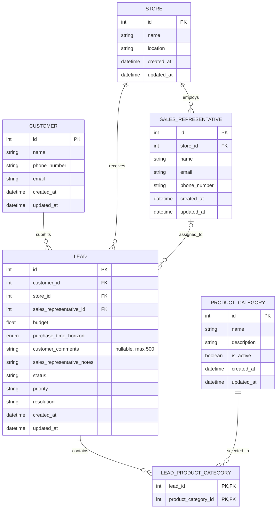

# Database Design

## Current Implementation Status

The application is configured to use `sqlite:///data.db` when `DATABASE_URL` is not set. On startup, it runs `db.create_all()`.

SQLAlchemy models are declared for customers, leads, stores, sales representatives, product categories, and the lead/product-category association. The customer service normalizes phone numbers, returns an existing customer when it finds the same number, or persists a new customer. The form captures product categories as areas of interest.

Only customer persistence is currently used by the intake workflow. Lead, store, product-category, and sales-representative persistence, seed data, and migrations are not implemented. The lead model includes a floating-point budget, an optional 500-character comments column, and a non-null purchase-horizon enum limited to the five supported choices.

## Target Database Design

The remaining database implementation should focus on:

1. Resolving submitted store and product-category values against database records
2. Persisting each submitted lead with its customer, store, and selected product categories
3. Returning a response containing the persisted lead's public identifier and initial status

Authentication, store dashboards, sales representative assignments, WhatsApp integration, automatic prioritization, and lead resolution workflows will be considered future milestones.

## Database Environment Strategy

The project will use different database engines depending on the environment:

1. Local development: SQLite (configured now; lead persistence remains to be implemented)
2. Remote/staging/production: MariaDB

Primary key IDs will not be generated as UUIDs by the application layer. Instead, each database engine will manage ID generation automatically using its native auto-increment behavior.

Design implication:

- Treat `id` fields as database-managed numeric primary keys.
- Keep foreign keys as matching numeric references to their related primary keys.

## Candidate Entities

### Customer

| Field          | Description                                                         |
| -------------- | ------------------------------------------------------------------- |
| `id`           | Database-managed unique customer identifier (auto-increment)        |
| `name`         | Customer's full name                                                |
| `phone_number` | Customer's phone number                                             |
| `email`        | Customer's email address                                            |
| `created_at`   | Timestamp indicating when the customer was first registered         |
| `updated_at`   | Timestamp indicating when the customer information was last updated |

#### Relationships

**Customer to Lead: one-to-many**

- The **Customer side is one**: each lead belongs to one customer.
- The **Lead side is many**: one customer can create multiple leads over time.
- This relationship is implemented by storing `customer_id` in the `Lead` table.

---

### Lead

| Field                        | Description                                                                             |
| ---------------------------- | --------------------------------------------------------------------------------------- |
| `id`                         | Database-managed unique lead identifier (auto-increment)                                |
| `customer_id`                | Reference to the customer who submitted the lead                                        |
| `store_id`                   | Reference to the store selected by the customer                                         |
| `sales_representative_id`    | Reference to the assigned sales representative; nullable until assignment               |
| `budget`                     | Customer's estimated purchase budget, stored as a floating-point value                  |
| `purchase_time_horizon`      | One of `one_month`, `three_months`, `six_months`, `more_six_months`, or `not_decided`  |
| `customer_comments`          | Additional comments, questions, or requests submitted by the customer (max 500 characters) |
| `sales_representative_notes` | Internal notes added by the assigned sales representative                               |
| `status`                     | Current lead status, such as `new`, `assigned`, `in_progress`, `closed`, or `cancelled` |
| `priority`                   | Lead priority or classification                                                         |
| `resolution`                 | Final result or outcome of the lead; nullable while the lead remains active             |
| `created_at`                 | Timestamp indicating when the lead was created                                          |
| `updated_at`                 | Timestamp indicating when the lead was last updated                                     |

#### Relationships

**Lead to Customer: many-to-one**

- The **Lead side is many**: multiple leads can belong to the same customer.
- The **Customer side is one**: each lead belongs to one customer.

**Lead to Store: many-to-one**

- The **Lead side is many**: a store can receive multiple leads.
- The **Store side is one**: each lead is associated with one selected store.

**Lead to Sales Representative: many-to-one**

- The **Lead side is many**: one sales representative can be responsible for multiple leads.
- The **Sales Representative side is one**: each lead can have one assigned sales representative at a time.
- The relationship is optional until the lead is assigned.

**Lead to Product Category: many-to-many**

- The **Lead side is many**: one product category can appear in multiple leads.
- The **Product Category side is also many**: one lead can include multiple categories of interest.
- This relationship requires the `LeadProductCategory` association table.

---

### Store

| Field        | Description                                                      |
| ------------ | ---------------------------------------------------------------- |
| `id`         | Database-managed unique store identifier (auto-increment)        |
| `name`       | Store name                                                       |
| `location`   | Store location or address                                        |
| `created_at` | Timestamp indicating when the store was registered               |
| `updated_at` | Timestamp indicating when the store information was last updated |

#### Relationships

**Store to Lead: one-to-many**

- The **Store side is one**: each lead is associated with one store.
- The **Lead side is many**: one store can receive multiple leads.
- This relationship is implemented by storing `store_id` in the `Lead` table.

**Store to Sales Representative: one-to-many**

- The **Store side is one**: each sales representative belongs to one store.
- The **Sales Representative side is many**: one store can have multiple sales representatives.
- This relationship is implemented by storing `store_id` in the `SalesRepresentative` table.

---

### Sales Representative

| Field          | Description                                                                     |
| -------------- | ------------------------------------------------------------------------------- |
| `id`           | Database-managed unique sales representative identifier (auto-increment)        |
| `store_id`     | Reference to the store where the sales representative works                     |
| `name`         | Sales representative's full name                                                |
| `email`        | Sales representative's email address                                            |
| `phone_number` | Sales representative's phone number                                             |
| `created_at`   | Timestamp indicating when the sales representative was registered               |
| `updated_at`   | Timestamp indicating when the sales representative information was last updated |

#### Relationships

**Sales Representative to Store: many-to-one**

- The **Sales Representative side is many**: multiple sales representatives can belong to the same store.
- The **Store side is one**: each sales representative belongs to one store.

**Sales Representative to Lead: one-to-many**

- The **Sales Representative side is one**: each assigned lead has one sales representative at a time.
- The **Lead side is many**: one sales representative can manage multiple leads.
- This relationship is implemented by storing `sales_representative_id` in the `Lead` table.

---

### Product Category

| Field         | Description                                                                  |
| ------------- | ---------------------------------------------------------------------------- |
| `id`          | Database-managed unique product category identifier (auto-increment)                  |
| `name`        | Category name, such as `bed`, `table`, `chair`, or `sofa`                            |
| `description` | Optional description of the product category                                       |
| `is_active`   | Indicates whether the category can currently be selected in the customer form       |
| `created_at`  | Timestamp indicating when the product category was registered                         |
| `updated_at`  | Timestamp indicating when the product category information was last updated           |

#### Relationships

**Product Category to Lead: many-to-many**

- The **Product Category side is many**: one category can be selected in multiple leads.
- The **Lead side is also many**: one lead can be associated with multiple categories.
- This relationship is implemented through the `LeadProductCategory` association table.

---

### Lead Product Category

The `LeadProductCategory` entity is an association table used to represent the many-to-many relationship between leads and product categories.

| Field                 | Description                    |
| --------------------- | ------------------------------ |
| `lead_id`             | Reference to a lead            |
| `product_category_id` | Reference to a product category |

#### Relationships

**LeadProductCategory to Lead: many-to-one**

- The **LeadProductCategory side is many**: one lead can have multiple entries in the association table.
- The **Lead side is one**: each `LeadProductCategory` record references one lead.

**LeadProductCategory to Product Category: many-to-one**

- The **LeadProductCategory side is many**: one product category can have multiple entries in the association table.
- The **Product Category side is one**: each `LeadProductCategory` record references one product category.

Together, these two many-to-one relationships create the many-to-many relationship between `Lead` and `ProductCategory`.

### Future Specific Product

A future `Product` table may track individual products or inventory items when that information becomes relevant to store operations. The customer form should continue to request only `product_category`; specific product selection is not part of the current customer experience. A future implementation can associate individual products with a product category and add a separate lead-to-product relationship without changing the current category-based form.

## Relationship Summary

| First Entity         | Relationship | Second Entity        | Explicit Cardinality                                                                                  |
| -------------------- | ------------ | -------------------- | ----------------------------------------------------------------------------------------------------- |
| Customer             | One-to-many  | Lead                 | One customer can have many leads; each lead has one customer                                          |
| Store                | One-to-many  | Lead                 | One store can have many leads; each lead has one store                                                |
| Store                | One-to-many  | Sales Representative | One store can have many sales representatives; each sales representative has one store                |
| Sales Representative | One-to-many  | Lead                 | One sales representative can have many leads; each assigned lead has zero or one sales representative |
| Lead                 | Many-to-many | Product Category     | One lead can have many product categories, and one category can appear in many leads                 |
| Lead                 | One-to-many  | LeadProductCategory  | One lead can have many association records; each association record has one lead                     |
| Product Category     | One-to-many  | LeadProductCategory  | One category can have many association records; each association record has one category              |

### High-Level Entity Relationship Diagram

The following diagram represents the proposed high-level database design.

Some entities and relationships are included to document the broader system vision and may not be implemented during the initial milestone.

